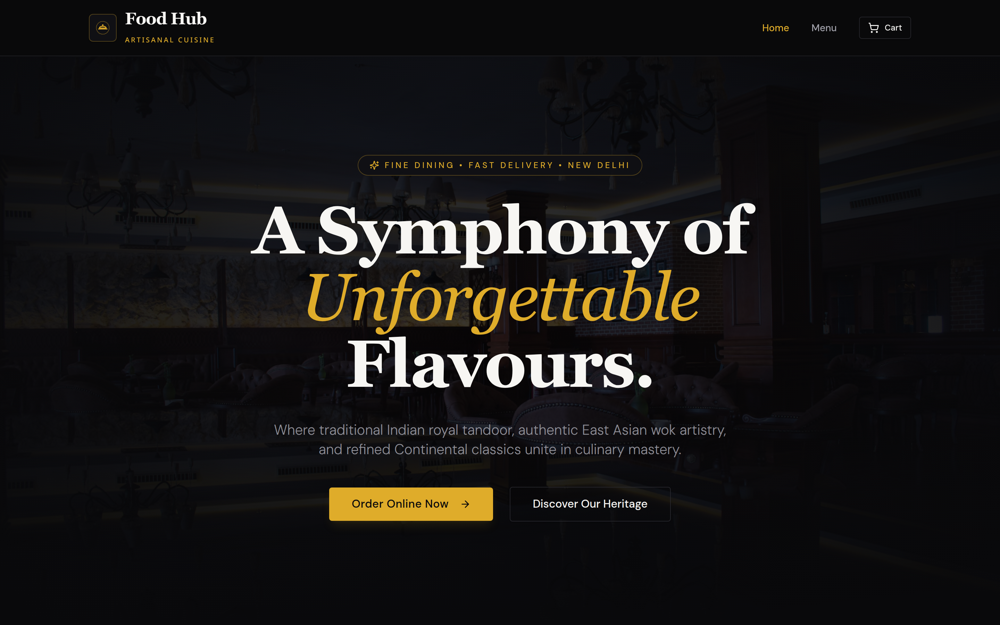
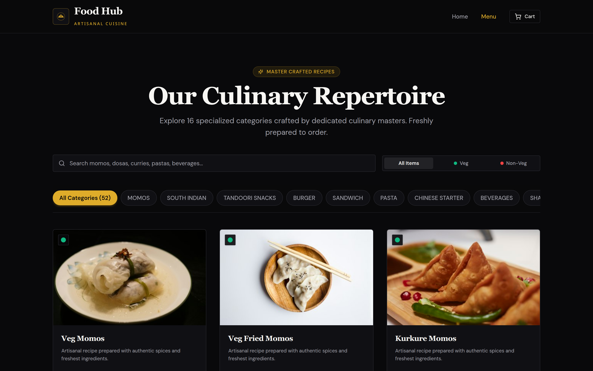
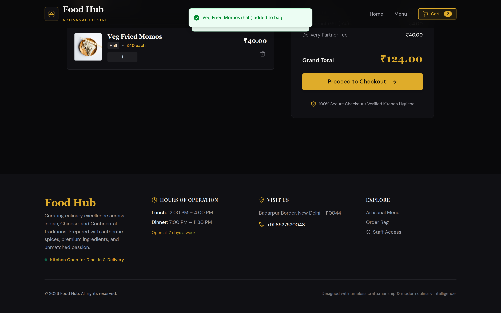
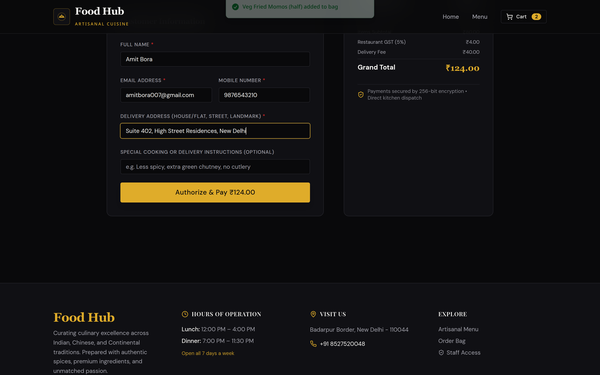
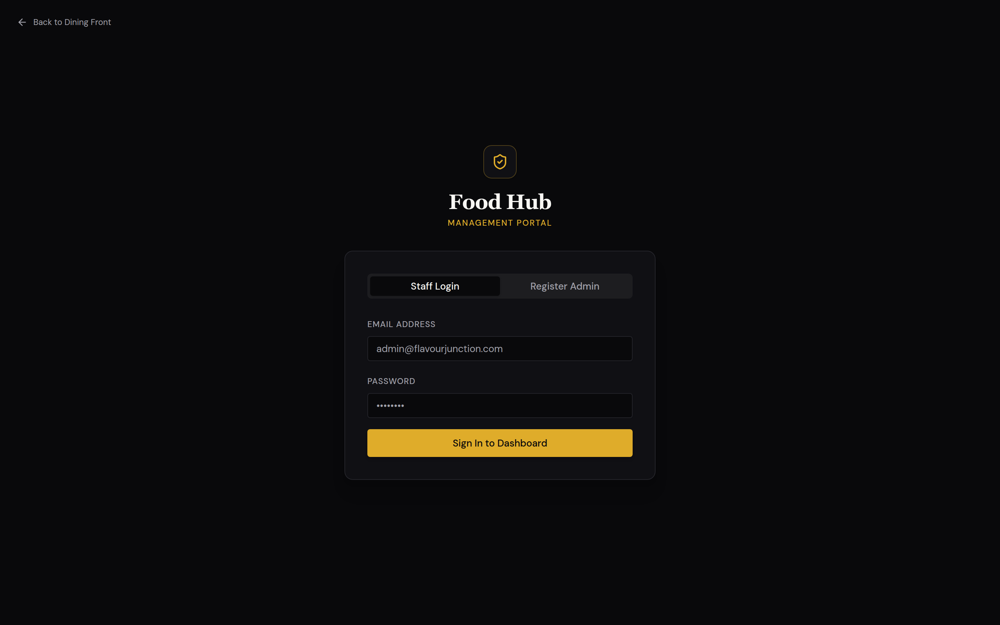
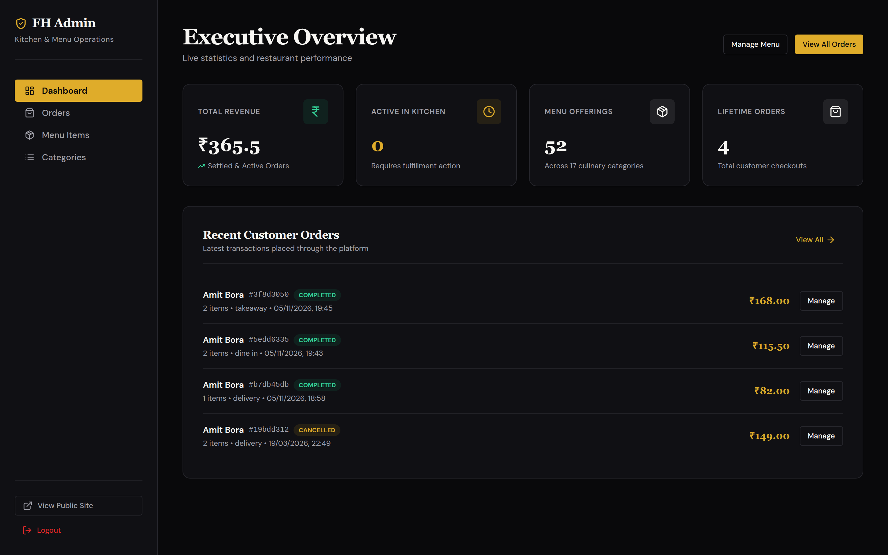
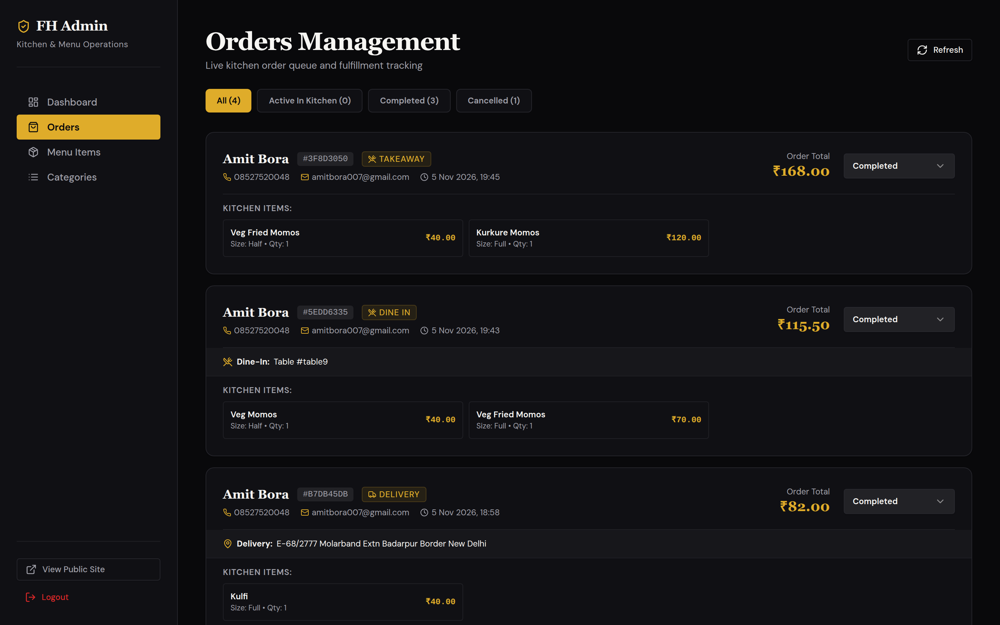
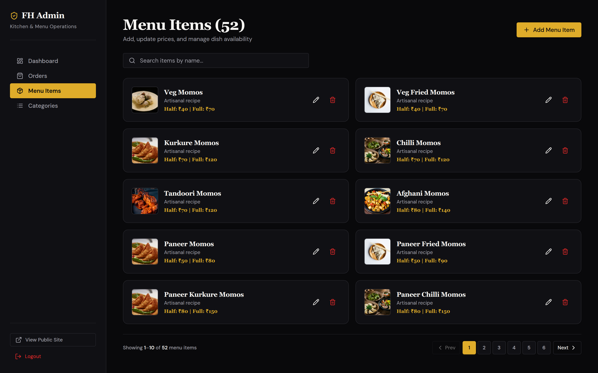
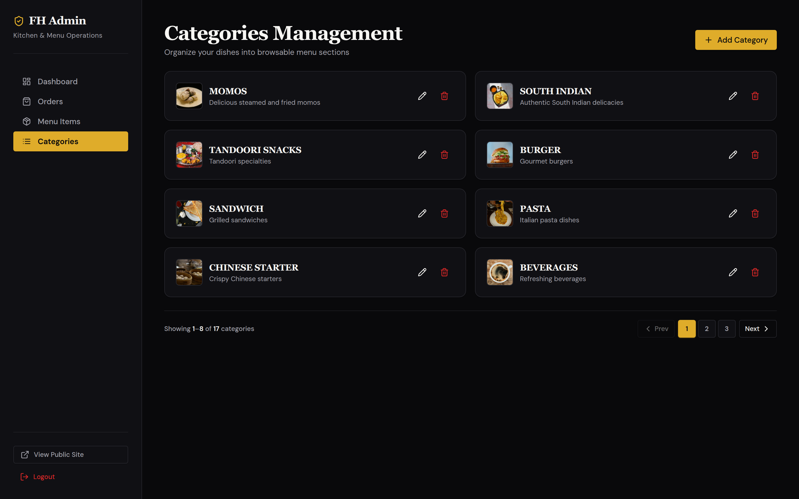

<div align="center">

# 🍽️ Food Hub — Artisanal Cuisine & Kitchen Management Platform

[](https://react.dev/)
[](https://fastapi.tiangolo.com/)
[](https://tailwindcss.com/)
[](https://www.mongodb.com/)
[](https://render.com/)
[](https://jwt.io/)

A full-stack, enterprise-grade restaurant dining and operations platform. Built with a bespoke dark-luxury aesthetic for diners and a high-efficiency command center for kitchen staff and executive management.

[Explore Menu](#-customer-dining-experience) • [Admin Portal](#-admin-back-office--kitchen-management) • [Screenshots](#-visual-walkthrough--screenshots) • [Local Setup](#-quickstart--local-setup) • [Render Deploy](#-render-one-click-deployment)

---

</div>

## 📸 Visual Walkthrough & Screenshots

### 1. Dining Front — Luxury Hero Experience
A responsive, high-contrast dark theme with golden typography (`Playfair Display` serif & `DM Sans`), featuring brand storytelling and instant ordering access.



---

### 2. Interactive Menu Catalog & Portion Controls
Explore 16+ culinary categories with instant text search, vegetarian/non-vegetarian filter toggles, dual-portion pricing (Half / Full), and paginated navigation.



---

### 3. Shopping Bag & Order Summary
Real-time cart synchronization with itemized cost calculation, automatic 5% restaurant GST, and conditional free delivery thresholds.



---

### 4. Checkout & Order Fulfillment
Three distinct fulfillment modes: **Home Delivery** (with full address), **Dine-In** (with Table Number), and **Takeaway**, backed by Razorpay secure payment processing.



---

### 5. Staff & Executive Authentication Portal
Dedicated management login and new manager registration secured with cryptographic JWT authentication and administrative registration keys.



---

### 6. Executive Operations Dashboard
Instant visibility into restaurant health: Total Settled Revenue, Active Kitchen Orders counter, Lifetime Orders, Menu statistics, and recent customer transactions.



---

### 7. Live Kitchen Queue & Status Management
Real-time ticket queue for chefs and dispatch staff. Update orders dynamically across their entire lifecycle (`Pending` ➔ `Confirmed` ➔ `Preparing` ➔ `Out for Delivery` ➔ `Completed` / `Cancelled`) with paginated order history.



---

### 8. Dish & Menu Management
Create, update prices (Half/Full), toggle dish availability, upload dish imagery, and delete dishes with instant search and server-side pagination.



---

### 9. Category Management
Organize menus into browsable categories with custom photography, descriptions, and sort orders.



---

## 🔐 Admin Access Credentials

Use the pre-configured administrator account to access the operations suite immediately:

| Field | Value | Notes |
| :--- | :--- | :--- |
| **Login URL** | `http://localhost:3000/admin/login` | Also accessible via the footer "Staff Access" link |
| **Email** | `amitbora007@gmail.com` | Primary Superadmin Account |
| **Password** | `amitbora12` | Pre-seeded credentials |
| **Registration Key** | `admin123` | Required only when registering new manager accounts |

---

## 🌟 Key Capabilities

### 🍷 Customer Dining Experience
- **Luxury Dark Aesthetic**: Handcrafted dark slate background (`#0c0a09`) with warm amber gold highlights (`#f59e0b` / `#d97706`).
- **Half & Full Portion Steppers**: Diners can choose between portion sizes per dish, with individual pricing and cart item grouping.
- **Dietary Filter Badges**: Quick visual indicators and filter chips for Pure Vegetarian and Non-Vegetarian selections.
- **Fulfillment Flexibility**:
  - 🛵 **Delivery**: Address input, landmark specifications, and auto delivery fee calculations.
  - 🍽️ **Dine-In**: Direct table ordering with assigned table number.
  - 🥡 **Takeaway**: Immediate counter pickup with expedited kitchen packaging.
- **Fast Pagination**: Effortless browsing across large menus without scroll exhaustion.
- **Payment Processing**: Integrated Razorpay modal with seamless test-mode fallback for local evaluation.

### 👨‍🍳 Admin Back-Office & Kitchen Management
- **Executive KPI Cards**: Real-time revenue analytics, active kitchen workload, menu catalog size, and total orders.
- **Live Kitchen Dispatch Screen**: Filter orders by status (`Active in Kitchen`, `Completed`, `Cancelled`), view order items, quantities, portions, customer phone numbers, and delivery notes.
- **Dynamic Catalog Control**: Add new dishes, adjust pricing, upload images, and update category allocations on the fly.
- **Paginated Tables & Grids**: Clean pagination controls across all admin datasets (Orders, Menu Items, and Categories).
- **Security & Authorization**: Protected routes (`<ProtectedRoute>`) requiring valid JWT bearer tokens stored in localStorage.

---

## 🛠️ Tech Stack & Architecture

### Frontend
- **Framework**: [React 19](https://react.dev/) initialized via standard `npm` (no external bundlers or CRACO dependencies).
- **Styling**: [Tailwind CSS 3.4](https://tailwindcss.com/) with `@tailwindcss/typography`.
- **Icons**: [Lucide React](https://lucide.dev/).
- **Motion & Transitions**: [Framer Motion](https://www.framer.com/motion/).
- **Networking**: [Axios](https://axios-http.com/).
- **Toasts & Feedback**: [Sonner](https://sonner.emilkowal.ski/).
- **Routing**: [React Router DOM v6](https://reactrouter.com/).

### Backend
- **Framework**: [FastAPI](https://fastapi.tiangolo.com/) (Python 3.11+ / 3.14).
- **Database Driver**: [Motor](https://motor.readthedocs.io/) (Asynchronous MongoDB driver).
- **Database**: MongoDB 6.0+ or MongoDB Atlas Cloud.
- **Validation**: [Pydantic v2](https://docs.pydantic.dev/).
- **Security & Hashes**: PyJWT (HS256) & Passlib (Bcrypt).
- **Payment Gateway**: [Razorpay Python SDK](https://github.com/razorpay/razorpay-python).
- **Server**: [Uvicorn](https://www.uvicorn.org/) ASGI.

---

## 📋 Prerequisites

Before running the platform locally, verify you have the following installed:
- **Node.js** (v18 or higher, v22 recommended) — `node -v`
- **npm** (comes bundled with Node.js) — `npm -v`
- **Python** (v3.11 or higher) — `python3 --version`
- **MongoDB** (Local instance running on `localhost:27017` or a free [MongoDB Atlas](https://www.mongodb.com/cloud/atlas) connection URI).

---

## 🚀 Quickstart & Local Setup

### 1. Clone & Navigate to Project
```bash
git clone https://github.com/amitbora007/restaurant.git
cd restaurant
```

---

### 2. Backend Setup

```bash
# Navigate to the backend directory
cd backend

# Create a virtual environment
python3 -m venv venv

# Activate the virtual environment
# On Linux/macOS:
source venv/bin/activate
# On Windows:
# venv\Scripts\activate

# Upgrade pip and install dependencies
python -m pip install --upgrade pip
python -m pip install -r requirements.txt

# (Optional) Seed the database with 16 categories and 50+ dishes
python seed_data.py

# Start the FastAPI server with live reload
python -m uvicorn server:app --reload --host 0.0.0.0 --port 8001
```

Backend will be online at: **`http://localhost:8001`**  
Interactive Swagger API docs: **`http://localhost:8001/docs`**

---

### 3. Frontend Setup

Open a separate terminal window:

```bash
# Navigate to the frontend directory
cd frontend

# Install pure npm dependencies
npm install

# Start the React development server
npm start
```

Frontend will be online at: **`http://localhost:3000`**

---

## ⚙️ Configuration & Environment Variables

### Backend Configuration (`backend/.env`)

Create or update `backend/.env`:

```env
# MongoDB Connection (Local or Atlas URI)
MONGO_URL="mongodb://localhost:27017"
DB_NAME="restaurant_db"

# Allowed CORS origins (comma-separated or * for development)
CORS_ORIGINS="http://localhost:3000"

# JWT Secret Key (Use a strong cryptographic string in production)
JWT_SECRET_KEY="your-super-secret-jwt-key-change-this"

# Razorpay Payment Gateway (Optional in demo mode)
RAZORPAY_KEY_ID="rzp_test_your_key_id"
RAZORPAY_KEY_SECRET="your_razorpay_secret"
```

### Frontend Configuration (`frontend/.env`)

Create or update `frontend/.env`:

```env
REACT_APP_BACKEND_URL=http://localhost:8001
```

---

## ☁️ Render One-Click Deployment

This repository includes a production-ready Render Blueprint specification ([`render.yaml`](render.yaml)).

### Deploy Steps:
1. Push your repository to **GitHub** or **GitLab**.
2. Log in to your [Render Dashboard](https://dashboard.render.com/).
3. Click **New +** ➔ **Blueprint**.
4. Connect this repository. Render will automatically parse `render.yaml` and configure:
   - **`food-hub-api`**: FastAPI Web Service running on Python 3.
   - **`food-hub-web`**: React Static Site with automatic SPA routing rewrites.
5. In the Render Dashboard environment settings for `food-hub-api`:
   - Set `MONGO_URL` to your **MongoDB Atlas** connection string (`mongodb+srv://...`).
   - Set `JWT_SECRET_KEY` to a secure production secret.
   - (Optional) Set `RAZORPAY_KEY_ID` and `RAZORPAY_KEY_SECRET`.
6. Click **Apply**. Render will build and deploy both services with automatic HTTPS SSL!

---

## 🔌 API Reference Highlights

Explore the interactive API documentation at `http://localhost:8001/docs`.

### Public Endpoints
| Method | Endpoint | Description |
| :--- | :--- | :--- |
| `GET` | `/api/` | Health check and server version |
| `GET` | `/api/categories` | List categories (supports `?page=1&limit=10`) |
| `GET` | `/api/menu-items` | List menu items (supports `?category_id=...&page=1&limit=10`) |
| `POST` | `/api/orders` | Place a customer order |
| `POST` | `/api/payment/verify` | Verify Razorpay payment signature |

### Protected Endpoints (Requires `Authorization: Bearer <TOKEN>`)
| Method | Endpoint | Description |
| :--- | :--- | :--- |
| `POST` | `/api/auth/login` | Admin login & access token issuance |
| `POST` | `/api/auth/register` | Register new admin account (requires `admin_key`) |
| `GET` | `/api/orders` | List customer orders (supports pagination & status filter) |
| `PUT` | `/api/orders/{id}/status` | Transition order status in kitchen queue |
| `POST` | `/api/menu-items` | Create new dish offering |
| `PUT` | `/api/menu-items/{id}` | Update existing dish |
| `DELETE` | `/api/menu-items/{id}` | Delete dish offering |
| `POST` | `/api/categories` | Create new menu category |
| `PUT` | `/api/categories/{id}` | Update existing category |
| `DELETE` | `/api/categories/{id}` | Delete category |
| `POST` | `/api/upload-image` | Upload dish/category photography |

---

## 📄 License

This project is open-source and available under the [MIT License](LICENSE).
